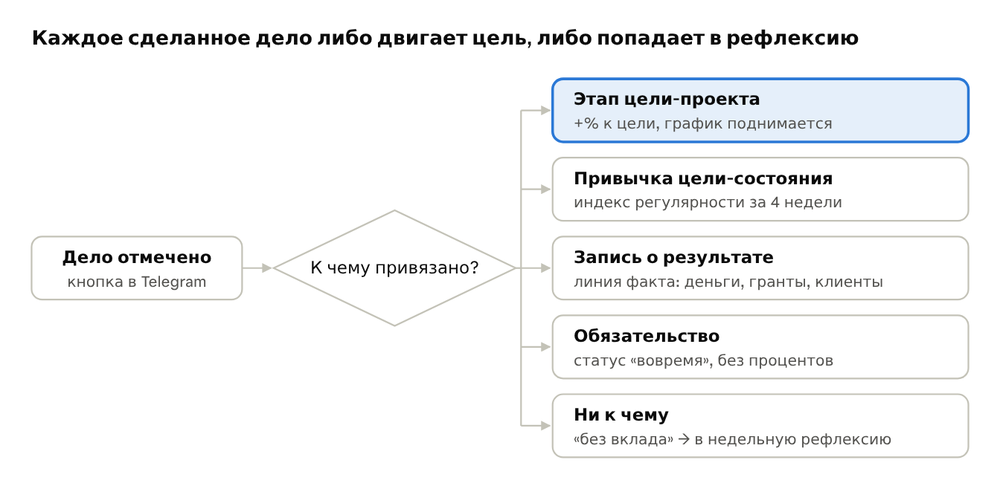
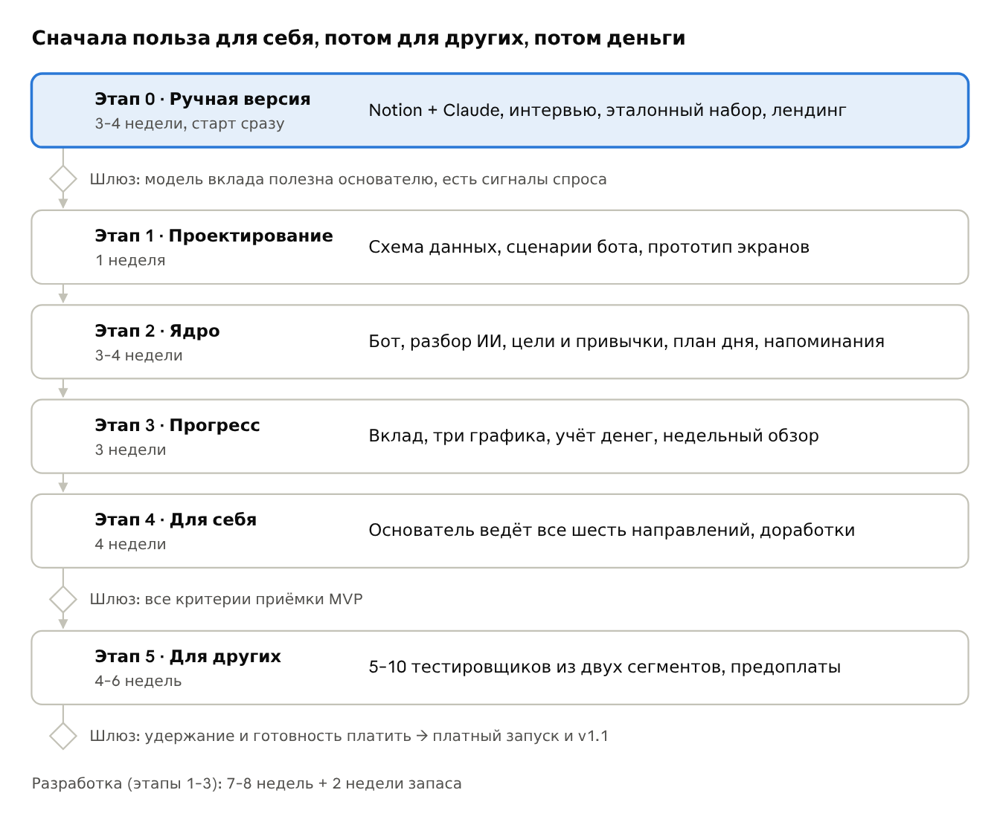

# AI Life & Growth OS — ТЗ v3.2

Nov 14, 2026 · @Лена

## О документе

Версия 3.2 — итоговое ТЗ для старта работ. Она строит продукт вокруг одной проверенной боли: «я много делаю, но не двигаюсь туда, куда нужно». Главное в продукте — видеть, как каждое действие двигает конкретную цель, и замечать дела, которые никуда не ведут.

Документ состоит из двух слоёв: спецификация MVP (что строим сейчас) и видение продукта в последнем разделе (что строим потом). Путь продукта: сначала для основателя, затем для 5–10 тестировщиков, затем платный запуск.

**Редакция 3.2** закрывает пробелы, найденные при проверке v3.1 перед стартом: пустой этап, вклад «задним числом», нормы привычек с разным периодом и частичные паузы, несравнимые проценты в графике 2, конфликт «записи против 70%», главная цель без дедлайна, этап у дополнительной цели, вход в Mini App, очередь напоминаний и бюджет. Все правки помечены «(v3.2)». Ручная версия (таблица + промпт для Claude) уже собрана по этим правилам.

**Редакция 3.1** закрывала пробелы, найденные внешней критикой v3.0: честный смысл процентов, все пять исходов сделанного дела, связь дела с несколькими целями, паузы в привычках, причина ручного закрытия этапа, правило доверия к ИИ, валюты и прибыль, первый запуск, вопросы интервью и условие остановки.

| Тема           | v2.0                                   | v3.1–3.2                                                                            |
|----------------|----------------------------------------|-------------------------------------------------------------------------------------|
| Центр продукта | Классификация задач и финансовые метки | Вклад каждого действия в цель и график прогресса                                    |
| Обещание       | «Какие дела приносят деньги»           | «Как ваши дела превращаются в результаты»; деньги — один из видов результата        |
| Типы целей     | Один                                   | Три: цель-проект, цель-состояние (здоровье), цель-результат (доход) + обязательства |
| Финансы        | Метки, учёт отложен                    | Правила категорий + минимальный учёт поступлений по проектам                        |
| Формат         | PWA                                    | Telegram-бот + веб-приложение, открывающееся внутри Telegram                        |
| Валидация      | 200 записей на лендинге                | Лестница сигналов до предоплаты                                                     |
| Эталон для ИИ  | Задачи основателя                      | Задачи 5–10 людей, две разметки                                                     |
| Архитектура    | Граф узлов, журнал событий             | Типизированные таблицы, журнал изменений                                            |
| Пороги ИИ      | Заданы заранее                         | Ставятся после замера базовой линии                                                 |
| Сроки          | 6–10 недель на 8 функций               | 8–10 недель на урезанное ядро; календарь и языки — в v1.1                           |

## Боль и персона

Первая персона — основатель. Дел нескончаемо много, она постоянно занята, но главные цели (ВНЖ, бизнес) почти не двигаются. Результат не соответствует затраченным усилиям, и непонятно, какие дела стоит усилить, а какие бросить.

**Шесть направлений жизни — они же стартовый шаблон продукта:**

| Направление                    | Примеры дел                                               | Что нужно от продукта                                                           |
|--------------------------------|-----------------------------------------------------------|---------------------------------------------------------------------------------|
| Здоровье и энергия             | Врачи, массаж, спорт, таблетки, вода, питание             | Напоминания о записях, привычки, видно, как регулярность влияет на самочувствие |
| Текущая жизнь и работа         | Коммуналка, смены на работе, встречи, мероприятия         | Ничего не забыть, но и не дать быту съесть весь день                            |
| Бизнес                         | Открыть, масштабировать, набрать команду                  | Шаги с весами, фактический доход, какие действия действительно приближают       |
| Социальные и грантовые проекты | Заявки на гранты, культурные и образовательные проекты    | Сроки подачи, статусы заявок, выигранные средства                               |
| Релокация                      | Перевод документов, шаги к ВНЖ, покупка недвижимости      | Чёткий маршрут с процентами, следующий шаг, сигнал, что цель стоит              |
| Обязательства                  | Налоговые отчёты компании и благотворительной организации | Дедлайны заранее, сделано вовремя — без стресса                                 |

**Что именно болит:**

- Все дела одинаково срочные на вид, и срочное всегда побеждает важное.

- Не видно, насколько сделанное приблизило к цели — нет ощущения движения.

- Шаги по долгим целям (ВНЖ) постоянно вытесняются и переносятся.

- Нельзя понять, какие дела — «лишние телодвижения», чтобы от них отказаться.

- Здоровье требует постоянного контроля десятков мелочей, и это само по себе утомляет.

**Гипотеза для рынка:** такая же боль есть у людей, чья жизнь состоит из многих независимых направлений: релоканты, предприниматели с основной работой, руководители общественных проектов. Объединяет их не страна, а задача: «много делаю, но не двигаюсь». Это проверяется на этапе 0.

## Обещание продукта и формат

**Обещание:** «Каждое дело показывает, насколько оно приблизило вас к цели. А то, что никуда не ведёт, вы увидите и сможете убрать». Деньги — один из видов результата, наряду со здоровьем, статусом и проектами.

Каждое слово обещания подкреплено функцией MVP: вклад действия, график цели, список дел без вклада, учёт фактических результатов. Продукт не обещает того, чего не умеет.

**Проценты — инструмент, а не суть продукта.** Главная ценность — увидеть связи между делами и целями, заметить застой, найти препятствия и принять решение. Процент показывает выполнение собственного плана человека, а не вероятность получить ВНЖ или доход.

**Стратегия.** Долгосрочно строим AI Life & Growth OS — систему управления жизнью. На рынок выходим через один проверяемый сценарий: «от действий к результатам».

**Формат: Telegram-бот + веб-приложение, которое открывается внутри Telegram (Mini App) и в браузере.**

| Часть                     | Для чего                                                                                | Почему так                                                                                       |
|---------------------------|-----------------------------------------------------------------------------------------|--------------------------------------------------------------------------------------------------|
| Telegram-бот              | Ввод дел текстом и голосом, утренний план, напоминания, отметка «сделано» одной кнопкой | Telegram уже открыт весь день; уведомления приходят надёжно; не нужен App Store                  |
| Веб-приложение (Mini App) | Графики, дерево целей, недельный обзор, настройки                                       | В чате графики и структура выглядят плохо; один код на React работает и в Telegram, и в браузере |

Риск формата — зависимость от одной платформы. Поэтому вся логика живёт на сервере, а веб-приложение работает и без Telegram. Нативные приложения iOS и Android — только после подтверждённого спроса.

**Путь от личного инструмента к продукту:**

1.  **Для себя.** Основатель пользуется каждый день; продукт доводится на реальной жизни.

2.  **Для 5–10 тестировщиков.** Люди с похожей болью проверяют, что продукт работает не только для основателя.

3.  **Платный запуск.** Только после шлюза по удержанию и готовности платить.

Архитектура с первого дня многопользовательская, чтобы переход от шага 1 к шагу 2 не требовал переделки.

## Пользовательские сценарии MVP

MVP — это шесть сценариев, а не набор модулей. Каждый проверяется на живом человеке.

| Сценарий                            | Вопрос пользователя                         | Что делает продукт                                                              | Пример                                                           |
|-------------------------------------|---------------------------------------------|---------------------------------------------------------------------------------|------------------------------------------------------------------|
| 1\. Записать                        | «Вспомнила — надо записать, пока не забыла» | Текст или голосовое в Telegram, за 5 секунд                                     | «Купить витамин D до пятницы»                                    |
| 2\. Разложить                       | «Куда это относится?»                       | ИИ предлагает направление, цель, шаг и тип дела                                 | → Здоровье · цель «Энергичность» · привычка «Добавки»            |
| 3\. Решить, что сегодня             | «Что делать прямо сейчас?»                  | План дня с одним «главным шагом» к главной цели                                 | Главный шаг: «Заказать перевод свидетельства» (ВНЖ)              |
| 4\. Увидеть движение                | «Я сделала — это что-то дало?»              | После отметки — вклад в цель и график                                           | «+6% к плану ВНЖ, теперь 34%»                                    |
| 5\. Понять, что мешает и что лишнее | «Почему я не двигаюсь?»                     | Ожидания, застой целей, дела без вклада, идеи перераспределения                 | «По ВНЖ ни одного шага за 3 недели; 9 часов ушло на мероприятие» |
| 6\. Увидеть результат               | «Что реально изменилось?»                   | Недельный обзор: действия, прогресс, фактические результаты, деньги по проектам | «Грант одобрен: +€8 000 проекту; спорт 3 из 3»                   |

Цифры в примерах условные.

## Первый запуск

Цель — первая польза за 10 минут: человек видит свои дела разложенными по целям и получает первый план с «главным шагом». Никакого чистого листа «опишите свою жизнь».

1.  Старт в Telegram-боте (или в вебе с привязкой бота кодом). Предупреждение о данных и согласие.

2.  Выбор направлений из шаблона (здоровье, текущая жизнь, бизнес, общественные проекты, релокация, обязательства) — лишнее снимается, своё добавляется.

3.  «Назовите 1–3 самые важные цели» — ИИ определяет тип каждой и предлагает черновик этапов или норм привычек; пользователь правит и подтверждает.

4.  «Выгрузите всё, что держите в голове» — голосовое, текст или CSV. ИИ раскладывает дела по целям, неясные — во «Входящие».

5.  Время утреннего плана и день недельного обзора.

6.  Первый план дня и карточки целей с нулевой точкой графика.

Шаги 2–5 можно пропустить и вернуться позже. Жизненное видение продукт предлагает сформулировать на третьем недельном обзоре.

## Модель целей

Цели бывают трёх типов, и прогресс у них считается по-разному. Одна формула на всё давала бы чепуху: здоровье нельзя «достичь на 100%», а ВНЖ нельзя потерять за неделю бездействия. Отдельно от целей существуют обязательства.

| Тип                         | Примеры                                                   | Как считается прогресс                                                                             | Как ведёт себя график                                |
|-----------------------------|-----------------------------------------------------------|----------------------------------------------------------------------------------------------------|------------------------------------------------------|
| **Цель-проект**             | Получить ВНЖ; открыть бизнес; провести грантовый проект   | Этапы с весами; сделанные шаги накапливают % до 100%                                               | Только растёт; рядом линия нужного темпа до дедлайна |
| **Цель-состояние**          | Быть здоровой и энергичной                                | Индекс регулярности за последние 4 недели: сколько из запланированных привычек и визитов выполнено | Идёт и вверх, и вниз: пропуск спорта опускает линию  |
| **Цель-результат**          | Доход бизнеса €N в месяц; 2 выигранных гранта в год       | Фактическое значение относительно целевого; меняет его только пользователь                         | Линия факта; ожидаемое показано пунктиром отдельно   |
| **Обязательство** (не цель) | Налоги, коммуналка, продление документов, смены на работе | Не процент, а статус: вовремя / риск / просрочено                                                  | Нет графика; счётчик «всё закрыто вовремя»           |

**Почему обязательства вынесены отдельно.** Налоговый отчёт не приближает ни к одной мечте, но и лишним делом не является. Если считать его «делом без вклада», продукт начнёт подталкивать к штрафам. Для обязательств цель — сделать вовремя и минимальными усилиями.

**Иерархия в интерфейсе — четыре уровня:** Направление → Цель → Этап → Дело. Проект — это цель типа «проект», отдельный уровень не нужен. Дело может жить без цели.

**Одно дело — несколько целей.** У дела есть основная цель и до трёх дополнительных. Пример: культурное мероприятие двигает грантовый проект (основная) и личный бренд бизнеса (дополнительная). Правила:

- Вклад засчитывается в каждую связанную цель, если дело входит в её этап.

- Время считается один раз — по основной цели, чтобы часы в обзоре не удваивались.

- Дополнительные связи ИИ только предлагает, ставит их пользователь: иначе каждое дело будет «двигать всё».

**Шаблоны этапов.** Для типичных целей (ВНЖ, открытие компании, грантовая заявка) ИИ предлагает черновик этапов с весами, пользователь правит и подтверждает. Для ВНЖ и других юридических процедур черновик помечен «проверьте по официальным источникам или у юриста»: ИИ не знает актуальных требований конкретной страны.

**Пример цели-проекта «ВНЖ» (веса условные):**

| Этап                                     | Вес |
|------------------------------------------|-----|
| Выбрать основание и проконсультироваться | 10% |
| Собрать и перевести документы            | 30% |
| Финансовые доказательства и жильё        | 25% |
| Подать заявление                         | 20% |
| Получить решение и карту                 | 15% |

## Вклад действия в цель

Сразу после отметки «сделано» продукт отвечает одной строкой, что изменилось: «+6% к плану ВНЖ (28% → 34%)» или «Спорт: 2 из 3 на этой неделе, индекс здоровья 72%». Способ расчёта зависит от того, к чему привязано дело.

{width=6in}

куда идёт сделанное дело · 5 исходов

**Пять исходов сделанного дела:**

| Исход                | Когда                                                       | Что меняется                                                 | Ответ бота                         |
|----------------------|-------------------------------------------------------------|--------------------------------------------------------------|------------------------------------|
| 1\. Шаг цели-проекта | Дело входит в этап                                          | Процент плана цели                                           | «+6% к плану ВНЖ (28% → 34%)»      |
| 2\. Отметка привычки | Дело — повторение привычки цели-состояния                   | Индекс регулярности                                          | «Спорт: 2 из 3 на неделе»          |
| 3\. Результат        | Дело зафиксировало измеримый факт (оплата, решение, клиент) | ИИ предлагает запись о результате, пользователь подтверждает | «Записать €1 200 в доход бизнеса?» |
| 4\. Обязательство    | Тип дела — обязательство                                    | Статус «вовремя», счётчик закрытых в срок                    | «Налоговый отчёт сдан вовремя»     |
| 5\. Без вклада       | Нет связи ни с чем                                          | Ничего; дело и его время идут в недельную рефлексию          | «Сделано. К целям не привязано»    |

Одно дело может дать несколько исходов (шаг + результат). Исход определяется привязкой, сделанной при разборе, а не угадывается в момент отметки. Если привязки нет, а ИИ видит вероятную связь, бот спрашивает одной кнопкой: «Это шаг к цели Х?»; без ответа — исход 5.

**Цель-проект.** У каждого дела в этапе есть размер: маленькое = 1, среднее = 2, большое = 4 (ИИ предлагает, пользователь меняет одним нажатием). Прогресс цели:

**Прогресс = Σ по этапам (W этапа × размер сделанных дел ÷ размер всех дел этапа)**

Пример: этап «Документы» весит 30% и состоит из дел суммарным размером 10. Сделанное среднее дело даёт 30% × 2/10 = +6% к цели.

**Пустой этап (v3.2).** Если в этапе ещё нет дел, его доля равна 0%, а в карточке цели показывается подсказка «добавьте шаги». Деления на ноль нет. Отменённые дела не входят ни в числитель, ни в знаменатель.

**Вклад «задним числом» (v3.2).** Ответ бота и точка на графике 1 показывают вклад **в момент отметки**: он сохраняется в журнале изменений и больше не меняется. Текущий процент цели считается по текущему составу этапов. Если в этап добавили дела, процент честно снижается с подписью «цель выросла: +N шагов», но прошлые точки графика не переписываются.

**Что означает процент.** 34% — это выполнение собственного плана, а не «34% пути до ВНЖ» и не вероятность. В интерфейсе он называется «план выполнен на 34%». Карточка цели показывает четыре вещи раздельно:

1.  Сделанные шаги (список, без процентов).

2.  Оценочный прогресс плана по этапам.

3.  Фактический результат (заявление принято, решение получено).

4.  Риски и внешние зависимости («ждём переводчика 9 дней»).

**Важность ≠ размер.** Размер описывает трудоёмкость, а важность задают веса этапов. Поэтому ключевые решения («выбрать основание ВНЖ», «консультация юриста») оформляются отдельными этапами со своим весом, а не тонут среди мелких дел. Шаблоны ИИ строятся по этому правилу.

**Цель-состояние (здоровье).** У каждой привычки есть норма: спорт 3 раза в неделю, вода каждый день, массаж 2 раза в месяц, врачи по записи. Индекс = среднее выполнение норм за последние 4 недели, каждая норма не выше 100%.

**Как норма переводится в окно 28 дней (v3.2).** Ожидаемое число = норма × активные дни ÷ длина периода: день = 1, неделя = 7, месяц = 30,4 дня. Активные дни = 28 − дни паузы в окне. Пауза может быть общей (все привычки) или для одной привычки, поэтому неделя с паузой автоматически получает меньшую норму. Для врачей («по записи») ожидаемое число = количество запланированных записей в окне. Если ожидаемое = 0, привычка выпадает из индекса, а не даёт 0%. Плюс необязательная оценка энергии от 1 до 5 одним нажатием вечером: через 4+ недели видно, как регулярность совпадает с самочувствием (без выводов о причинах).

**Правила для цели-состояния:**

- Привычки весят одинаково; вес можно изменить.

- **Пауза:** «болею», «отпуск», «не зависит от меня». Дни паузы исключаются из расчёта и показываются на графике серой полосой, а не падением.

- **Врачи:** в индекс идёт действие человека — «записалась» и «пришла по записи», а не доступность врача.

- Привычку можно завершить или изменить норму; история сохраняется, индекс считается по действующим нормам.

- Индекс называется «регулярность», а не «здоровье»: продукт не оценивает состояние здоровья.

**Правила честности:**

- Дело засчитывается один раз; повторяющиеся дела не двигают цели-проекты, только индекс привычек.

- Добавление новых дел в этап честно снижает %, но подписывается: «цель выросла: +2 шага», чтобы падение не выглядело неудачей.

- Этап можно закрыть вручную только с причиной: «результат достигнут другим способом» засчитывает этап целиком; «дела неактуальны — этап изменён» убирает лишние дела и пересчитывает процент; «этап отменён» снимает его вес с перераспределением по остальным. Причина пишется в историю.

- «Подать заявку» двигает прогресс, «получить ВНЖ / грант / оплату» — фактический результат. Это разные линии на графике.

- Расчёты воспроизводимы и покрыты автотестами.

## Графики прогресса

Три графика отвечают на три вопроса: «двигаюсь ли я к цели?», «куда уходят мои силы?» и «как я себя чувствую?». Все три живут в веб-приложении, а в Telegram приходит краткая сводка со ссылкой.

| График                                    | Что показывает                                                                                                                    | Как читается                                                     |
|-------------------------------------------|-----------------------------------------------------------------------------------------------------------------------------------|------------------------------------------------------------------|
| **1. Линия цели** (на каждую цель-проект) | Прогресс в % по дням; пунктир — нужный темп до дедлайна; точки — сделанные дела (наведите — видно, какое дело и сколько дало)     | Линия ниже пунктира = отстаём; горизонтальный участок = застой   |
| **2. Силы и вклад за неделю**             | По каждому направлению два столбика рядом: сколько часов потрачено и сколько % прогресса **целей-проектов** получено; отдельный столбик «без вклада» (v3.2: проценты плана и пункты регулярности несравнимы и не складываются; привычки в этом графике показываются только часами) | Много часов и мало прогресса — повод для рефлексии               |
| **3. Здоровье и энергия**                 | Индекс регулярности за 4 недели и оценка энергии 1–5 на одной шкале времени                                                       | Пропуски опускают линию; видно, совпадает ли она с самочувствием |

**Главный экран «Цели»** — карточка на каждую цель: название, текущий %, мини-график за 30 дней, изменение за неделю («+12%» или «стоит 19 дней») и следующий шаг кнопкой «в план на завтра».

**Чтобы график 2 работал, нужно время.** Вести точный учёт никто не будет, поэтому время берётся из размера дела (15 минут / 1 час / полдня). При отметке «сделано» можно поправить одним нажатием: «заняло больше». Для долгих дел в боте есть необязательный таймер «начала / закончила», а для дел со временем в календаре — их длительность. Все часы в обзоре помечены знаком «≈»: это оценка для сравнения направлений, а не табель. Точный учёт времени продукт не обещает.

## Рефлексия: дела без вклада

Продукт не запрещает «лишние» дела и не стыдит за них. Он раз в неделю показывает, куда ушли силы, и предлагает одно-два решения, а выбирает всегда человек.

**Дела без вклада делятся на три вида:**

| Вид                   | Примеры                                                | Что предлагает продукт                                                |
|-----------------------|--------------------------------------------------------|-----------------------------------------------------------------------|
| Неизбежные            | Налоги, коммуналка, смены на работе                    | Упростить: сгруппировать в один день, автоплатёж, передать бухгалтеру |
| Бытовые и ситуативные | Встречи, мелкие просьбы, организация чужих мероприятий | Привязать к цели, если связь есть; иначе — лимит часов в неделю       |
| Не ведущие никуда     | Дела «на всякий случай», перенесённые больше 3 раз     | Закрыть как неактуальные или делегировать                             |

**Сигналы для перераспределения** (не более трёх в неделю, с цифрами):

- **Застой цели:** «По ВНЖ ни одного шага 19 дней. Следующий шаг — заказать перевод (1 час). Поставить главным шагом на завтра?»

- **Несоразмерность:** «На мероприятие ушло 9 часов и 0% к целям, на бизнес — 2 часа и +8%».

- **Вечный перенос:** «Это дело переносилось 4 раза. Сделать, делегировать или закрыть?»

- **Проседание здоровья:** «Спорт 1 из 3 две недели подряд. Поставить тренировки в календарь как встречи?»

**Что продукт не делает:** не удаляет дела сам, не называет человека неэффективным, не считает отдых и семью «потерей времени». Отдых можно привязать к цели-состоянию «энергия».

## План дня и недельный обзор

Каждый день в плане есть один «главный шаг» к главной цели недели. Это прямой ответ на боль «срочное всегда побеждает важное»: даже в самый забитый день ВНЖ или бизнес сдвигается хотя бы на один шаг.

**Утро (сообщение бота, 5 минут):**

1.  Вопрос: «Сколько у вас сегодня свободных часов?» — кнопки 1 / 2 / 4 / 6+. (В v1.1 — из Google Calendar.)

2.  План на 60–70% этого времени в таком порядке:

    1.  Записи и дедлайны сегодня (врач, налоги, подача гранта).

    2.  Главный шаг к главной цели.

    3.  Привычки здоровья по недельной норме.

    4.  Работа и дела с прямым доходом.

    5.  Шаги по другим целям — сначала по тем, что дольше стоят.

    6.  Быт и необязательное — если осталось время.

3.  Пользователь меняет порядок или принимает план одной кнопкой.

**Если записи и дедлайны сами занимают больше 70% (v3.2).** Записи и дедлайны в план попадают всегда, даже сверх лимита. Тогда бот прямо пишет «день перегружен: обязательное ≈5 ч из 6» и предлагает перенести всё необязательное. Главный шаг остаётся в плане хотя бы в виде самого маленького дела (размер S). Критерий приёмки «≤ 70%» относится к делам категорий b–f.

Задачи «жду ответа» и заблокированные в план не попадают, а собраны в блоке «Жду от других» с предложением напомнить человеку.

**День:** напоминания о записях (за день и за 2 часа) и покупках («таблетки заканчиваются»). Отметка «сделано» — кнопкой прямо в сообщении, в ответ — вклад в цель.

**Вечер (необязательно, 30 секунд):** оценка энергии 1–5 и что из плана перенести. Перегруженный день не переносится целиком: каждому делу — «завтра / дата / делегировать / закрыть».

**Недельный обзор (15 минут, день выбирает пользователь):**

1.  Что сдвинулось: линии целей и фактические результаты (сначала хорошее).

2.  Куда ушли силы: график «часы и вклад» по направлениям.

3.  Сигналы рефлексии — до трёх, с решениями одним нажатием.

4.  Чистый старт: закрыть или перенести устаревшее.

5.  Выбор главной цели недели. ИИ предлагает цель-проект, которая сильнее всего отстаёт от темпа. Если ни у одной цели нет дедлайна, предлагает ту, что дольше всего стоит без шага. Цель-состояние главной не бывает: её поддерживают привычки в плане дня (v3.2).

## ИИ: разбор задач, автономность, ошибки

ИИ разбирает дела в фоне и никогда не заставляет ждать: дело сохраняется мгновенно, разбор приходит через несколько секунд ответом бота.

**Что определяет ИИ для нового дела:** направление; цель и этап (или «без цели»); тип (шаг, привычка, запись на время, обязательство, покупка); размер; дату и время, если они есть в тексте; возможный дубликат. Контекст — список целей и этапов пользователя; для MVP его хватает целиком, поиск по смыслу — когда целей станет больше 30.

**Одно сообщение — несколько дел.** «Завтра врач в 10, потом оплатить свет и написать юристу про ВНЖ» разбивается на три дела в трёх направлениях.

**Автономность:**

| ИИ делает сам (видно в ленте, отмена одним нажатием)                 | ИИ спрашивает                                                   |
|----------------------------------------------------------------------|-----------------------------------------------------------------|
| Создать дело и привязать к существующей цели при высокой уверенности | Новая цель, этап или направление                                |
| Поставить размер, тип, напоминания                                   | Веса этапов и нормы привычек                                    |
| Составить план дня и недельный отчёт                                 | Склеить дубликаты, закрыть или удалить дела                     |
| Предложить следующий шаг                                             | Обновить фактический результат (деньги, ВНЖ получено)           |
| —                                                                    | Любые действия во внешнем мире (письма, платежи) — в MVP их нет |

**Качество.** Пороги точности не задаются заранее. На этапе 0 измеряем два числа: базовую точность ручной версии на Claude и потолок — насколько человек согласен сам с собой при повторной разметке. Цель MVP — не ниже базовой линии. Дубликаты проверяются на отдельном наборе из ~50 пар.

**Правило доверия — когда ИИ можно действовать самому:**

1.  ИИ возвращает уверенность для каждого разбора. Три зоны: высокая — применить и показать в ленте; средняя — предложить одной кнопкой «да / другое»; низкая — оставить во «Входящих».

2.  Граница «высокой» зоны подбирается на эталонном наборе так, чтобы среди автоматически применённых разборов было **не менее 90% верных**. Если таких разборов меньше половины — ИИ в MVP только предлагает, но не применяет.

3.  Дубликаты никогда не склеиваются автоматически, независимо от уверенности.

4.  В работе: если за неделю пользователь исправил больше 10% автоматических разборов, высокая зона для него сужается.

5.  Новая модель или промпт выкатывается только после прогона по эталонному набору, и только если они не хуже текущих.

Цифры 90% и 10% — стартовые допущения; они проверяются на этапе 0.

**Ошибки ИИ:**

- Таймаут, неверный ответ или недоступность провайдера → дело сохраняется во «Входящие» без разбора, ничего не теряется; повтор через минуту.

- ИИ не уверен → карточка с 2–3 вариантами и кнопкой «без цели».

- Каждое исправление пользователя сохраняется и попадает в примеры для следующих разборов этого же пользователя.

- Внешний текст (пересланные сообщения) — только данные, а не команды для ИИ.

**Лимиты:** не более 5 новых дел из одного сообщения; по умолчанию не более 3 уведомлений в день плюс напоминания о записях; дневной лимит ИИ-операций на пользователя.

## Финансовые категории и учёт результатов

Главное правило: **категория описывает, как дело связано с деньгами, а сумма и её статус хранятся в записях о деньгах.** ИИ не угадывает доходность дел.

**Категория задаётся на уровне цели, дела её наследуют.** Цель «Бизнес» — потенциальный доход, и все её дела получают эту категорию. Делам без цели ИИ предлагает категорию с вариантом «не знаю».

| Категория                     | Правило                                                 | Примеры                                                  |
|-------------------------------|---------------------------------------------------------|----------------------------------------------------------|
| Прямой доход                  | Есть согласованная оплата: зарплата, заказ, счёт        | Смена на работе; выполнить оплаченный заказ              |
| Потенциальный доход           | Деньги возможны, но не договорены                       | Письмо потенциальному клиенту; набор команды для бизнеса |
| Ресурсы проекта               | Деньги приходят проекту или организации, а не вам лично | Заявка на грант для культурного проекта                  |
| Развитие доходного потенциала | Отдача отложена и косвенна                              | Обучение, нетворкинг, портфолио                          |
| Управление активами           | Расход или действие, привязанное к имуществу            | Покупка недвижимости; ремонт сдаваемой квартиры          |
| Защита от потерь              | Не приносит денег, но предотвращает штрафы и сбои       | Налоговые отчёты, продление документов, коммуналка       |
| Нефинансовое                  | Ценность не в деньгах                                   | Здоровье, семья, ремонт своего жилья                     |

**Учёт результатов (минимум для MVP, без бухгалтерии):**

- Запись о деньгах добавляется одной фразой в боте: «получила зарплату €1 200», «грант одобрен €8 000».

- Поля: сумма, валюта, цель, дата, статус (подтверждено / ожидается / гипотеза), доход или расход. Персональные деньги и деньги проекта различаются.

- В недельном обзоре по каждой цели: деньги за месяц и часы за месяц рядом. Статусы не складываются.

- При записи подтверждённого дохода продукт спрашивает: «Какие дела к этому привели?» и предлагает недавние дела этой цели. Так накапливаются реальные цепочки от действия к деньгам (анализ цепочек — после MVP).

**Правила счёта:**

- **Прибыль цели** = подтверждённые доходы − подтверждённые расходы за период. Ожидаемое показывается рядом отдельной строкой, гипотезы — только в карточке цели.

- **Валюты:** каждая запись хранится в своей валюте. У пользователя есть базовая валюта; итоги пересчитываются по курсу на дату записи и помечены «≈».

- Одна запись относится к одной цели; общий доход делится на несколько записей вручную.

- Когда ожидаемые деньги пришли, запись меняет статус, а не дублируется. В MVP нет налогов, банковских интеграций и бухгалтерских отчётов.

Продукт не даёт финансовых советов и не прогнозирует доход.

## Объём MVP и версия 1.1

MVP включает только то, без чего не работает ни один из шести сценариев. Учёт результатов добавлен за счёт переноса календаря и языков в v1.1.

| Что                                                 | MVP | v1.1 | После |
|-----------------------------------------------------|-----|------|-------|
| Telegram-бот: текст, голосовые, кнопки, напоминания | Да  |      |       |
| ИИ-разбор дел с лентой и отменой                    | Да  |      |       |
| Три типа целей + обязательства, этапы, привычки     | Да  |      |       |
| Вклад действия и три графика                        | Да  |      |       |
| План дня с «главным шагом», «жду ответа»            | Да  |      |       |
| Недельный обзор с рефлексией                        | Да  |      |       |
| Учёт денег по целям (три статуса)                   | Да  |      |       |
| Шаблоны этапов (ВНЖ, бизнес, грант)                 | Да  |      |       |
| Экспорт и удаление данных, импорт CSV               | Да  |      |       |
| Интерфейс на русском                                | Да  |      |       |
| Чтение Google Calendar                              |     | Да   |       |
| Украинский и английский интерфейс                   |     | Да   |       |
| Импорт из Todoist                                   |     | Да   |       |
| Оплата подписки                                     |     | Да   |       |
| Интерактивная интеллект-карта                       |     |      | Да    |
| Анализ цепочек «дело → доход»                       |     |      | Да    |
| Нативное приложение с Apple Health / Google Fit     |     |      | Да    |
| Совместная работа (семья, команда проекта)          |     |      | Да    |

**До разработки — ручная версия.** (v3.2: комплект готов — таблица `Life_OS_ручная_версия.xlsx` с формулами этого ТЗ и промпт для Claude Project в папке `life-os/manual`.) Уже на этой неделе основатель ведёт систему в Notion или Google Sheets: цели с весами этапов, дела с размером и простой график процента. Разбор дел и недельный обзор делает Claude по готовому промпту. Это даёт пользу сразу и проверяет модель вклада до написания кода.

## Архитектура и модель данных

Архитектура простая, но многопользовательская с первого дня: переход «для себя → для тестировщиков → для клиентов» не требует переделки.

**Стек:** Supabase (PostgreSQL, Auth, RLS, Edge Functions) · веб-приложение React + TypeScript, оно же Telegram Mini App (старт в Lovable, код в GitHub) · Telegram-бот как Edge Function на вебхуках · распознавание речи через API · LLM через один ИИ-шлюз (схемы JSON, лимиты, учёт стоимости, смена провайдера).

**Ключевые решения:**

- Типизированные таблицы вместо универсального графа; проверка на циклы — только для зависимостей между делами.

- Прогресс считается из текущего состояния; для графиков раз в сутки сохраняется снимок процентов по каждой цели.

- Журнал изменений с состоянием «до/после» — основа отмены и истории.

- Время — в UTC, у пользователя — часовой пояс; повторения — по стандарту RRULE.

- Изменение структуры: при переносе дела в другую цель его вклад пересчитывается; архивная цель сохраняет свои снимки; удалённое 30 дней лежит в корзине.

**Надёжность:**

- **Конфликты правок.** Если одно дело меняют из бота и из веба одновременно, сохраняется последняя правка по каждому полю; предыдущее значение остаётся в журнале и восстанавливается.

- **Напоминания** уходят через очередь с повтором: если Telegram недоступен, сообщение доставляется позже, а не теряется.

- **Восстановление:** ежедневный бэкап, ежемесячная пробная распаковка; отмена любого действия из журнала в течение 30 дней.

| Таблица            | Что хранит                                                                                                          |
|--------------------|---------------------------------------------------------------------------------------------------------------------|
| profiles           | Пользователь, Telegram ID, язык, часовой пояс, время утреннего плана и обзора                                       |
| areas              | Направления жизни                                                                                                   |
| goals              | Цели: тип (проект / состояние / результат), дедлайн, финансовая категория, целевое значение                         |
| milestones         | Этапы целей-проектов с весами                                                                                       |
| tasks              | Дела: тип, размер, статус, срок, время, основная цель, этап, переносы, «жду от» |
| task_goals         | Дополнительные цели дела (до трёх): goal_id **и milestone_id** — чтобы дело двигало этап каждой связанной цели (v3.2) |
| task_dependencies  | Зависимости между делами                                                                                            |
| habits             | Привычки целей-состояний: норма, правило повторения                                                                 |
| check_ins          | Отметки привычек и оценка энергии                                                                                   |
| money              | Денежные записи и связь с делами, которые к ним привели                                                             |
| contributions      | Вклад дела в каждую цель, зафиксированный в момент отметки (для графика 1 и ответа бота) (v3.2) |
| reminders_queue    | Очередь уведомлений с повтором (v3.2) |
| progress_snapshots | Снимки прогресса для графиков                                                                                       |
| change_log         | Журнал изменений пользователя и ИИ                                                                                  |
| ai_suggestions     | Разборы ИИ, уверенность, решение пользователя, стоимость                                                            |

У каждой записи есть user_id, и каждая таблица закрыта RLS-политикой «только своё» с автотестами.

**Дополнения v3.2:**

- **Вход в Mini App.** Сервер (Edge Function) при каждом открытии проверяет подпись `initData`, которую передаёт Telegram (HMAC с ключом бота), и срок её действия. Только после этого он выдаёт сессию Supabase для этого `telegram_id`. Без проверки любой может открыть приложение под чужим ID. В браузере вход — обычный Supabase Auth (почта), а бот привязывается одноразовым кодом.
- **Очередь напоминаний.** `pg_cron` раз в минуту выбирает наступившие напоминания и кладёт их в очередь `pgmq`. Edge Function отправляет их в Telegram. При ошибке сообщение возвращается в очередь с повтором через 1, 5 и 30 минут, после 5 попыток помечается как недоставленное и попадает в журнал.
- **Расчёты в одном месте.** Формулы прогресса, индекса и вклада живут в одном модуле на TypeScript, который используют и Edge Functions, и тесты. Во фронтенде расчётов нет.

## Безопасность и приватность

Продукт хранит очень личное: записи к врачам, доходы, иммиграционный статус. До первых внешних тестировщиков нужна консультация юриста по UK/EU GDPR и оценка воздействия на защиту данных (DPIA): данные о здоровье — особая категория. Ниже — требования, а не юридическая консультация.

- **Минимизация.** Продукт хранит «массаж в четверг в 15:00», но не спрашивает диагнозы, суммы на счетах и номера документов.

- **Регион и шифрование.** Supabase в регионе EU; шифрование при передаче и хранении; токены интеграций шифруются отдельно.

- **LLM-провайдер.** Договор обработки данных; данные не используются для обучения моделей; ИИ получает только нужный контекст.

- **Telegram.** Переписка с ботом хранится и на серверах Telegram — пользователь узнаёт об этом при подключении. Бот привязывается одноразовым кодом из веб-приложения.

- **Ключи и доступ.** API-ключи только на сервере; RLS на каждой таблице с автотестами.

- **Права пользователя.** Экспорт всех данных (JSON + CSV) и полное удаление аккаунта; ежедневные бэкапы с ежемесячной проверкой восстановления.

- **Тексты ИИ.** Никаких медицинских, юридических и финансовых советов: «по вашим данным…», а не «вам следует…». Шаблоны ВНЖ помечены как черновик для проверки.

## Этап 0: валидация и метрики успеха

Запись в список ожидания ничего не доказывает. Спрос проверяется лестницей сигналов — от слабого к сильному. Все пороги — стартовые допущения для обсуждения.

**Сегменты для проверки** (по задаче, а не по географии), по 8–10 интервью и отдельный вариант лендинга на каждый:

- **А. «Жизнь в нескольких измерениях»** — релоканты и предприниматели с основной работой, документами, проектами (профиль основателя).

- **Б. Мультидоходные специалисты** — фрилансеры и креативщики с 3+ источниками дохода.

Вынужденные переселенцы не входят в первую платную волну: чувствительные данные и низкая платёжеспособность.

**Лестница сигналов:**

| Сигнал                                | Сила    | Критерий                                                |
|---------------------------------------|---------|---------------------------------------------------------|
| Запись на лендинге                    | Слабый  | Не порог, а знаменатель; считаем по сегментам и каналам |
| Согласие стать активным тестировщиком | Средний | 15+ человек                                             |
| Пользуются прототипом 3 недели        | Сильный | Больше половины тестировщиков                           |
| Предоплата раннего доступа            | Сильный | 20–30 оплат от незнакомых людей                         |

**Критерий боли по интервью:** у ≥ 60% опрошенных в сегменте есть недавний случай, когда важная цель стояла из-за текучки, пропущен срок или потерян доход.

**Вопросы интервью** (о прошлом поведении, а не о желаниях):

- Расскажите про цель, которая давно стоит. Что мешало на прошлой неделе?

- Как вы сейчас решаете, чем заняться утром?

- Когда вы последний раз пропустили важный срок? Что произошло?

- Каким планировщиком вы пользовались и почему бросили?

- Что бы вас смутило, если бы ИИ раскладывал ваши дела и считал проценты?

**Условие остановки.** Если после этапа 0 не выполнен критерий боли ни в одном сегменте или сама основатель перестала пользоваться ручной версией — разработка не начинается. Пересматриваем модель вклада или сегмент и повторяем этап 0 один раз. Предоплаты и 3-недельное использование тестировщиками — условие платного запуска (этап 5), а не старта разработки.

**Эталонный набор для ИИ:** 200–300 дел от 5–10 разных людей, дела основателя — не больше трети. Часть дел размечают дважды, чтобы измерить потолок точности.

**Метрики после запуска — две группы:**

| Группа   | Метрика                                                                 |
|----------|-------------------------------------------------------------------------|
| Привычка | Недельный обзор 3 недели подряд                                         |
| Привычка | Доля дней, когда сделан «главный шаг»                                   |
| Польза   | Доля целей, у которых за месяц вырос прогресс или фактический результат |
| Польза   | Сроки и записи, выполненные вовремя после напоминания                   |
| Польза   | Доля сигналов рефлексии, по которым принято решение                     |
| Деньги   | Конверсия в оплату и удержание платящих на 2-м и 3-м месяце             |
| Деньги   | Расходы на ИИ на активного пользователя                                 |

«Сэкономленное время» — только самооценка в ежемесячном опросе. Цена подписки выбирается по предоплатам и интервью, а не по ценам конкурентов.

## Команда и план работ

От ручной версии до решения о платном запуске — около 5 месяцев. Польза для основателя начинается с первой недели — в ручной версии.

{width=6in}

план работ · 6 этапов, 3 шлюза

Сроки — оценка для одного full-stack разработчика с Lovable; уточняются после этапа 1. Если разрабатывает основатель сама с Lovable и Claude, заложить в 1,5–2 раза больше.

| Роль                               | Формат       | Когда      | За что отвечает                                        |
|------------------------------------|--------------|------------|--------------------------------------------------------|
| Основатель / продакт               | Постоянно    | Все этапы  | Решения, ручная версия, интервью, разметка, сообщество |
| Full-stack разработчик с опытом ИИ | Постоянно    | 1–4        | Бот, веб-приложение, база, ИИ-шлюз, тесты              |
| UX/UI-дизайнер                     | Частично     | 1–3        | Диалоги бота, графики, экраны «Цели» и «Обзор»         |
| Поведенческий психолог             | Консультации | 0, 3       | Подача прогресса, сигналы рефлексии без стыда          |
| Юрист по данным                    | Консультации | До этапа 5 | DPIA, политика конфиденциальности, условия             |
| Маркетолог / комьюнити             | Частично     | 0, 5       | Лендинг, поиск тестировщиков, предоплаты               |

## Критерии приёмки MVP

MVP готов к тестировщикам, когда выполнен каждый пункт и основатель 4 недели подряд ведёт в нём все шесть направлений своей жизни.

Каждый пункт проверяется одним из трёх способов: автотест (расчёты, RLS, формулы), сценарий ручной проверки на тестовом аккаунте (бот, напоминания, графики) или прогон по эталонному набору (ИИ). Пункт закрыт, когда проверка пройдена и записана.

- [ ] Дело записывается текстом или голосовым в Telegram за ≤ 5 секунд; из одного сообщения — несколько дел.

- [ ] При сбое ИИ дело не теряется, а попадает во «Входящие».

- [ ] Точность разбора на эталонном наборе не ниже базовой линии ручной версии.

- [ ] Любое действие ИИ видно в ленте и отменяется одним нажатием.

- [ ] Отметка «сделано» сразу показывает вклад: «+X% к цели», новое значение индекса или «без вклада».

- [ ] Проценты совпадают с ручным расчётом по формуле на тестовых данных (автотесты).

- [ ] Повторяющиеся дела не двигают цели-проекты, а пропуск привычки опускает индекс состояния.

- [ ] В плане каждого дня есть «главный шаг», план не превышает 70% указанного времени.

- [ ] Напоминания о записях приходят за день и за 2 часа, о дедлайнах документов — за 90, 30 и 7 дней.

- [ ] Все три графика работают на реальных данных основателя после 2 недель использования.

- [ ] Недельный обзор показывает до 3 сигналов рефлексии с цифрами и решениями одним нажатием.

- [ ] Подтверждённые, ожидаемые и гипотетические деньги нигде не складываются; личные и проектные деньги различаются.

- [ ] Тесты RLS проходят для второго пользователя; экспорт и удаление данных работают.

- [ ] Веб-приложение открывается и внутри Telegram, и в браузере.

<!-- -->

- [ ] Первый запуск даёт план дня и карточки целей за ≤ 10 минут.

- [ ] Дело с несколькими целями двигает каждую из них, а время считается один раз.

- [ ] Ручное закрытие этапа без причины невозможно; причина видна в истории.

- [ ] Дни паузы (болезнь, отпуск) не снижают индекс регулярности.

- [ ] В интерфейсе процент цели называется «план выполнен на X%», часы и пересчёт валют помечены «≈».

## Бюджет (v3.2)

Оценка в месяц на этапах 0–4. Цены ориентировочные, перед оплатой их нужно проверить на сайтах сервисов.

| Статья | Этап 0 (ручная версия) | Разработка (этапы 1–4) | 5–10 тестировщиков |
|---|---|---|---|
| Claude (подписка основателя) | уже есть | уже есть | уже есть |
| Lovable | 0 | ≈ $25–50 | ≈ $25–50 |
| Supabase | 0 | 0 (бесплатный план) | ≈ $25 (Pro: бэкапы, без засыпания) |
| LLM для разбора дел (через API) | 0 | ≈ $5–15 | ≈ $1–3 на активного пользователя |
| Распознавание речи | 0 | ≈ $2–5 | ≈ $0,5–2 на пользователя |
| Домен, лендинг | ≈ $0–15 | ≈ $1–2 | ≈ $1–2 |
| Юрист по данным (DPIA, политика) | — | — | разово ≈ €500–1 500 |

Главная переменная — кто разрабатывает (открытый вопрос 1). Если основатель с Lovable и Claude, денежные расходы минимальны, но сроки в 1,5–2 раза длиннее.

## Риски и открытые вопросы

Самый важный риск — что проценты и графики не дадут ощущения движения или покажутся нечестными. Поэтому модель вклада проверяется вручную до написания кода.

| Риск                                     | Вероятность               | Что делаем                                                         |
|------------------------------------------|---------------------------|--------------------------------------------------------------------|
| Проценты кажутся произвольными           | Средняя                   | Проверка в ручной версии; веса и размеры меняются одним нажатием   |
| Отток через 2–3 недели                   | Высокая                   | Ввод в Telegram, главный шаг дня, недельный обзор, чистый старт    |
| Система станет ещё одним источником вины | Средняя                   | Никаких красных стен, сначала хорошее, отдых не считается потерей  |
| Продукт подогнан под одного человека     | Средняя                   | 5–10 тестировщиков до платного запуска; эталон из дел разных людей |
| Зависимость от Telegram                  | Низкая                    | Логика на сервере, веб-приложение работает отдельно                |
| Утечка личных данных                     | Низкая, ущерб критический | RLS с автотестами, минимизация данных, DPIA                        |
| Расходы на ИИ растут быстрее выручки     | Средняя                   | Лимиты, дешёвая модель для разбора, учёт стоимости каждого вызова  |

**Открытые вопросы:**

- [ ] Кто разрабатывает: основатель с Lovable и Claude, фрилансер или наёмный разработчик? От этого зависят сроки и бюджет.

- [ ] Какие нормы здоровья и веса этапов основатель ставит себе в ручной версии?

- [ ] Какой сервис распознавания речи лучше понимает смешанную русско-украинскую речь?

- [ ] Какой LLM использовать на старте — решить по замеру на эталонном наборе.

- [ ] Как принимать оплату: через веб (Stripe) или внутри Telegram — проверить актуальные правила Telegram для цифровых товаров.

- [ ] Нужен ли семейный режим (общие дела с партнёром) и режим команды грантового проекта?

## Видение продукта после MVP

Конечная цель — AI Life & Growth OS: система, которая помогает не просто успевать больше, а видеть, как действия превращаются в результаты — финансовые, профессиональные и жизненные. Идеи v1.0 сохраняются и добавляются по мере подтверждения спроса.

| Возможность                                     | Что даёт                                                                      | Условие для старта                              |
|-------------------------------------------------|-------------------------------------------------------------------------------|-------------------------------------------------|
| Интерактивная интеллект-карта жизни             | Стратегический взгляд раз в месяц, связи между целями; витрина для маркетинга | Пользователи регулярно открывают вид «Цели»     |
| Анализ цепочек «дело → результат»               | Какие виды дел реально приводят к деньгам, грантам, клиентам                  | Накоплено 3+ месяца данных                      |
| AI Strategic Advisor                            | Ежемесячный разбор стратегии и предложения перестроить цели                   | Сигналы рефлексии действительно принимаются     |
| Нативное приложение с Apple Health / Google Fit | Спорт и шаги учитываются сами, без отметок; виджеты                           | Платящие пользователи и бюджет на две платформы |
| Сценарное планирование                          | Сравнение вариантов: «если переехать в страну X сейчас / через год»           | Подтверждённая ценность советника               |
| Совместная работа                               | Семья, команда бизнеса или грантового проекта                                 | Запросы от платящих пользователей               |
| Интеграции (Gmail, документы, банки)            | Дела и доходы попадают в систему автоматически                                | Приватность и безопасность проверены            |

Из v1.0 в силе остаётся список «Что нельзя допустить»: не путать действие с результатом, не считать гипотетический доход фактическим, не менять цели без согласия, не терять историю, не делать продукт сложнее жизни, которой он помогает управлять.
